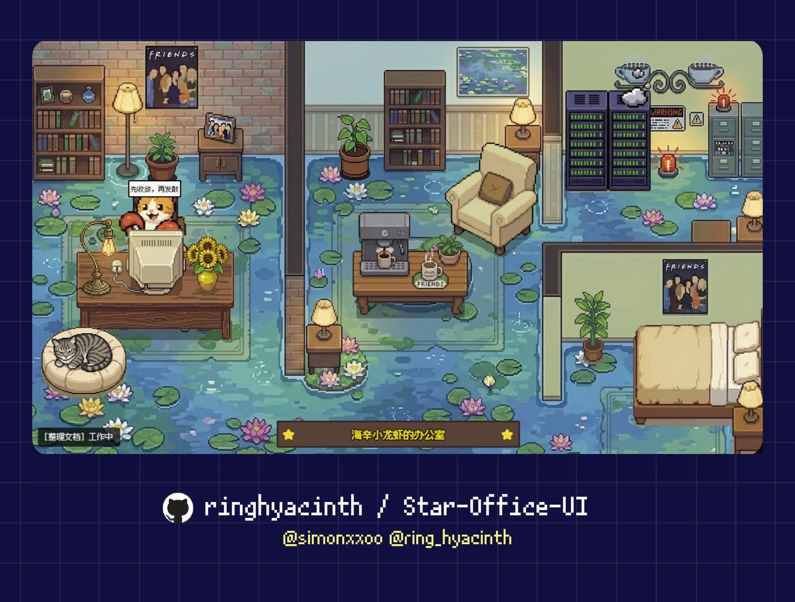

# Charisna Visual Agent Desk

> **The Official Real-Time Visual Virtual Office & Operations Hub for the Charisna SuperApp & Hermes AI Ecosystem.**



**Charisna Visual Agent Desk** is an interactive, pixel-art virtual office command center designed to monitor, visualize, and interact with autonomous AI agents across the **Charisna SuperApp** multi-business ecosystem.

---

## 🌟 Ecosystem & Core Team Agents

The workspace hosts a dedicated team of autonomous agents operating harmoniously:

| Agent | Avatar / Role | Mission & Focus Area | Default Station |
|---|---|---|---|
| **Hermes** | `star` (Chief AI Architect) | System orchestration, autonomous pair programming & core automation | Executive Desk & Lounge Sofa |
| **Onal AI** | `guest_anim_1` (Universal Memory) | Cross-session memory indexing, context retention & SOP documentation | Library & Archive Station |
| **Bumi POS** | `guest_anim_2` (Retail & Inventory) | Real-time cashier transactions, product stock & POS monitoring (Bumi Makmur) | Retail Counter Desk |
| **Homestay Bot** | `guest_anim_3` (Hospitality & Booking) | Unit occupancy, tenant ledger & booking coordination (Charisna Homestay) | Guest Lounge Area |
| **MoniFlow** | `guest_anim_4` (Ledger & Books) | Consolidated cashflow, audit trails & financial ledgers (MoniFlow) | Accounting Workstation |
| **Codex Dev** | `guest_anim_5` (DevOps Automator) | Autonomous CI/CD pipeline builds, code validation & test execution | Server Telemetry Terminal |
| **Kuro Patrol** | `guest_anim_6` (Security Sentinel) | System health checks, daemon integrity & security boundary enforcement | Office Corridor Patrol |

---

## ✨ Key Features

1. **Anti-Teleport Walking Engine**:
   - Agents never teleport. When transitioning between states (`idle`, `writing`, `syncing`, `error`), characters stand up, flip directionally, and walk smoothly across the floor with authentic retro step-bobbing.
2. **Point-and-Click Floor Navigation**:
   - Click anywhere on the office floor to guide Hermes to that spot with animated walking and visual click beacons.
3. **Interactive Environment & Dialogues**:
   - **Clickable Agents**: Click any team agent to trigger an energetic bounce and read their live status dialogue bubble.
   - **Coffee Machine**: Click to brew fresh coffee (`☕`) and invite Hermes or nearby agents over for a warm cup.
   - **Lounge Sofa & Workstations**: Click to invite Hermes to rest or start coding at his laptop.
   - **Server Room Rack**: Click to inspect real-time system uptime, CPU load, and service statuses.
   - **Office Cats & Plants**: Click to pet the purring office cats (`❤️ Purr... Meow!`) or bloom decorative plants.
   - **Wooden Plaque**: Click the gold-embossed plaque to rename the office anytime.
4. **Autonomous Office Roaming**:
   - Team agents periodically stroll around the room to grab coffee, inspect server racks, or discuss tasks, creating a lively virtual workspace.
5. **Responsive Widescreen & Zoom**:
   - Automatically adapts to wide monitors (up to 1600px+ / 96vw) with crisp pixel art rendering and mouse-wheel zoom-in/out support.
6. **Realtime Hermes Activity Watcher**:
   - Built-in daemon watcher passively monitors `agent.log` and automatically transitions Hermes from `idle` to `writing` / `executing` when busy, and back to `idle` when quiet.

---

## 🚀 Quick Start

### Prerequisites
- **Python 3.10+** (Python 3.11, 3.12, 3.13, 3.14 supported)
- Modern web browser (Chrome, Edge, Firefox, Safari)

### 1. Installation
```bash
# Clone the repository
git clone https://github.com/charisnasuperapp/hermes-visual-agent-desk.git
cd hermes-visual-agent-desk

# Install required dependencies
pip install -r backend/requirements.txt
```

### 2. Launch Backend
```bash
# Start the backend state service and Hermes activity watcher
python backend/app.py
```

The server will start listening at **http://127.0.0.1:19000**.

### 3. Open Dashboard
Open **http://127.0.0.1:19000** in your browser.

---

## 🛠️ API & State Control

### State Endpoints

- **`GET /status`**: Returns current workspace state, active office name, and Hermes detail.
- **`POST /set_state`**: Push new state to Hermes:
  ```json
  {
    "state": "writing",
    "detail": "Building new microservice module"
  }
  ```
- **`GET /agents`**: Returns full status list of all 7 team agents.
- **`POST /api/office/rename`**: Rename the office plaque:
  ```json
  {
    "officeName": "Charisna Office Workspace"
  }
  ```
- **`GET /yesterday-memo`**: Fetches yesterday's notes and summaries from `memory/*.md`.

### Command Line State Helper
```bash
python set_state.py writing "Compiling codebase"
python set_state.py syncing "Pushing git commits"
python set_state.py idle "Standby and resting in breakroom"
```

---

## 📁 Repository Structure

```
hermes-visual-agent-desk/
├── backend/
│   ├── app.py                 # Core Flask service & Hermes Realtime Watcher
│   ├── store_utils.py         # State persistence & runtime config storage
│   ├── memo_utils.py          # Daily memory log extractor
│   └── requirements.txt       # Python dependencies
├── frontend/
│   ├── index.html             # Main Phaser 3.80 virtual office client
│   ├── electron-standalone.html # Decoupled desktop shell frontend
│   ├── memo-bg.webp           # Clean notepad memo asset
│   ├── office_bg.webp         # 1280x720 base room pixel art
│   └── fonts/                 # ArkPixel proportional fonts
├── agents-state.json          # Persistent registry of team agents
├── runtime-config.json        # Runtime configurations & office name
├── state.json                 # Real-time state cache
└── pyproject.toml             # Project metadata
```

---

## 🔒 Security & Privacy

- All state data is stored locally on this machine (`127.0.0.1`).
- No external telemetry or credentials are sent to public servers without explicit approval.
- Built strictly following Hermes engineering safety guidelines.

---

## 📄 License

Proprietary project developed for the **Charisna SuperApp & Hermes AI Ecosystem**. All rights reserved.
